# SIMSKRIPSI: Sistem Informasi Skripsi Mahasiswa

Saya membuat SIMSKRIPSI untuk tugas mata kuliah Web Semantik (modul Web Service). Aplikasi ini mengelola pengajuan proposal, bimbingan, dan tahapan skripsi mahasiswa Universitas Muhammadiyah Bengkulu. Tampilannya mengikuti enam mockup dari dosen.

**NPM:** 2455201233
**Penyusun:** Brilian Anugra
**Demo online:** http://simskripsi-brilian.rf.gd

> **Semua data dan akun di README ini adalah contoh untuk demo.** Jangan memakai password aslimu di aplikasi ini. Demo online berjalan di HTTP tanpa enkripsi.

---

## Daftar Isi
1. [Teknologi](#teknologi)
2. [Fitur](#fitur)
3. [Tampilan Aplikasi](#tampilan-aplikasi)
4. [Web Service (REST API)](#web-service-rest-api)
5. [Menjalankan di Komputer Sendiri](#menjalankan-di-komputer-sendiri)
6. [Akun Demo](#akun-demo)
7. [Struktur Database](#struktur-database)
8. [Keamanan](#keamanan)
9. [Pengujian](#pengujian)
10. [Bug yang Ditemukan dan Diperbaiki](#bug-yang-ditemukan-dan-diperbaiki)
11. [Struktur Folder](#struktur-folder)
12. [Keterbatasan](#keterbatasan)

---

## Teknologi

| Bagian | Yang dipakai |
|---|---|
| Bahasa | PHP 8.x native, tanpa framework |
| Database | MySQL lewat PDO |
| Antarmuka | Bootstrap 5.3.3, Bootstrap Icons 1.11.3, Chart.js 4.4.3 (semua dari CDN jsDelivr) |
| Lingkungan lokal | Laragon (Apache dan MySQL) |
| Hosting demo | InfinityFree |

---

## Fitur

Aplikasi ini punya dua lapisan. Lapisan pertama adalah halaman PHP yang dirender server. Lapisan kedua adalah REST API read-only yang mengembalikan JSON, dan data ini nanti menjadi bahan untuk Web Semantik.

| Role | Yang bisa dilakukan |
|---|---|
| **Semua role** | Login, logout, dan membuka dashboard sesuai role |
| **Admin dan Kaprodi** | Melihat statistik (kartu, grafik donut, aktivitas terbaru), mengelola proposal (tambah, ubah, hapus, cari, filter, pagination), dan mengelola catatan bimbingan |
| **Dosen** | Melihat proposal, serta menambah dan menghapus catatan bimbingan pada proposal yang ia bimbing |
| **Mahasiswa** | Melihat tahapan skripsi di stepper, mengajukan proposal (maksimal satu proposal aktif), membuka proposal sendiri, dan menambah catatan bimbingan dengan lampiran PDF, DOC, atau DOCX sampai 2 MB |

---

## Tampilan Aplikasi

Semua gambar berasal dari versi online.

**1. Landing page**
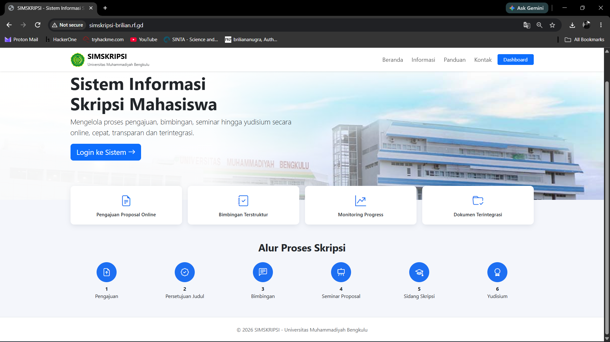

**2. Login**
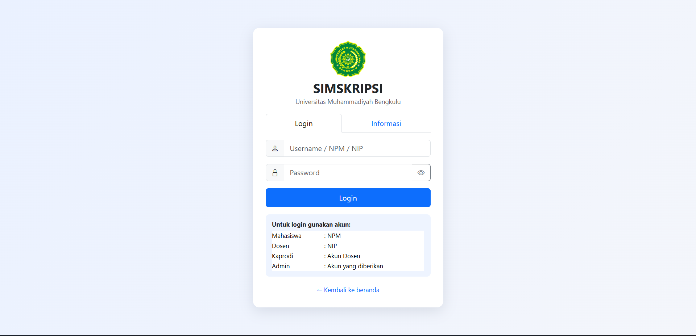

**3. Dashboard Admin**
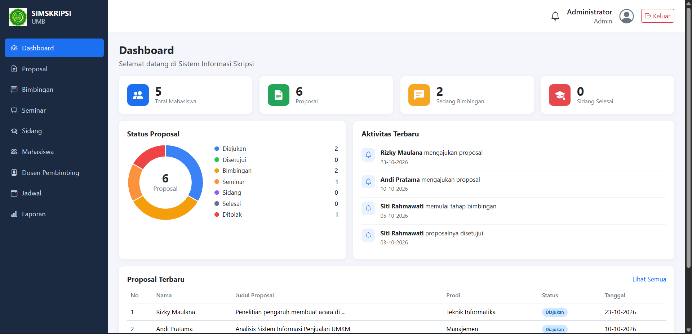

**4. Data Proposal (CRUD, pencarian, filter, pagination)**
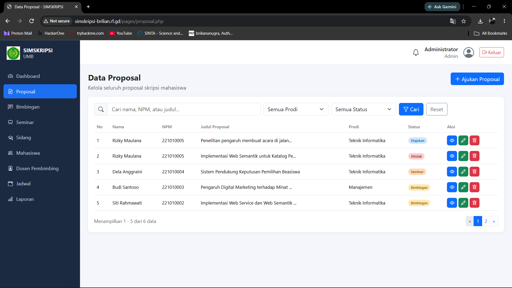

**5. Detail Proposal dan Bimbingan**
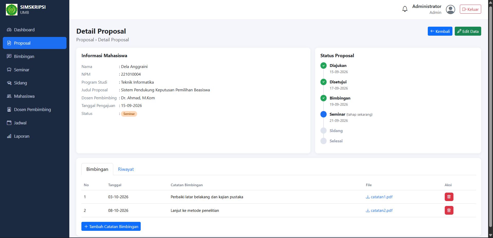

**6. Dashboard Mahasiswa**
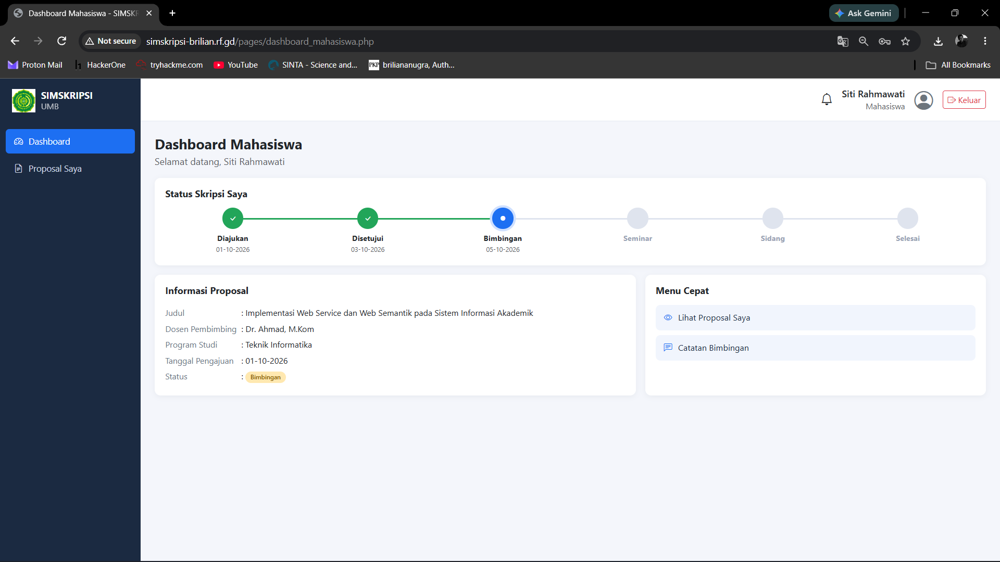

---

## Web Service (REST API)

Semua endpoint menerima GET dan mengembalikan JSON. Metode lain mendapat kode 405. Setiap endpoint meminta login, dan kamu bisa masuk dengan dua cara:

1. Sesi browser, setelah login lewat aplikasi.
2. HTTP Basic Auth dengan username dan password akun.

Kalau permintaan membawa keduanya, Basic Auth menang dan server tidak menyimpannya ke sesi.

| Endpoint | Fungsi | Parameter | Akses |
|---|---|---|---|
| `/api/proposal.php` | Daftar proposal | `q`, `status`, `prodi`, `page`, `per_page` (maksimal 50) | Semua role. Mahasiswa hanya melihat proposalnya sendiri |
| `/api/proposal.php?id=N` | Detail proposal dengan `riwayat_status` dan `bimbingan` | `id` | Sesuai hak akses proposal |
| `/api/bimbingan.php?proposal_id=N` | Catatan bimbingan satu proposal | `proposal_id` (wajib) | Sesuai hak akses proposal |
| `/api/statistik.php` | Total mahasiswa, total proposal, jumlah per status | tidak ada | Admin, Kaprodi, Dosen |

**Contoh respons sukses** (`/api/statistik.php`, data dari seeder):

```json
{
  "status": "ok",
  "data": {
    "total_mahasiswa": 5,
    "total_proposal": 5,
    "per_status": {
      "diajukan": 1, "disetujui": 0, "bimbingan": 2,
      "seminar": 1, "sidang": 0, "selesai": 0, "ditolak": 1
    }
  }
}
```

**Contoh respons error:**

```json
{ "status": "error", "pesan": "Proposal tidak ditemukan." }
```

**Kode status HTTP:**

| Kode | Arti | Contoh kejadian |
|---|---|---|
| 200 | Berhasil | Data dikembalikan |
| 400 | Permintaan tidak valid | Nilai `status` tidak dikenal, atau `proposal_id` kosong |
| 401 | Belum login atau kredensial salah | Tanpa login, atau password salah |
| 403 | Login sah, tetapi tidak berhak | Mahasiswa membuka statistik atau proposal milik orang lain |
| 404 | Tidak ditemukan | `id` proposal tidak ada |
| 405 | Metode tidak diizinkan | POST ke endpoint yang hanya menerima GET |
| 500 | Kesalahan server | Pengguna melihat pesan umum, detailnya masuk log server |

**Contoh pemakaian dengan Basic Auth** di komputer sendiri:

```bash
curl -u admin:password123 "http://localhost/simskripsi/api/proposal.php?status=bimbingan"
```

### Bukti hasil API

| Gambar | Keterangan |
|---|---|
| 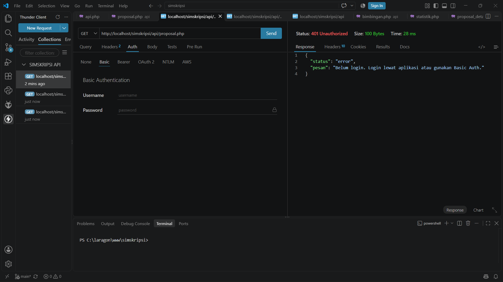 | Tanpa login, server menjawab 401 |
| 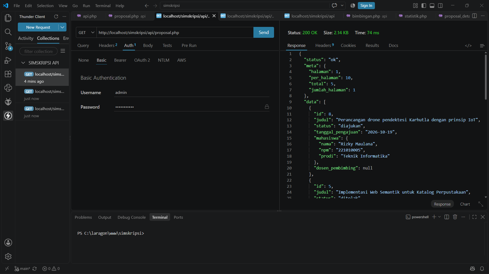 | Daftar proposal, 200 |
| 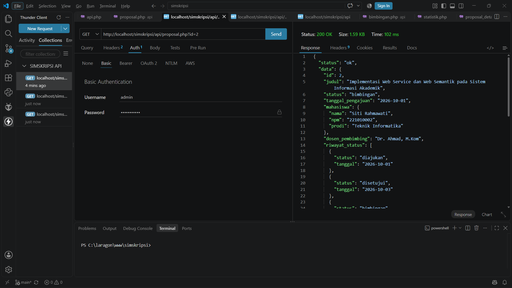 | Detail proposal dengan riwayat status |
| 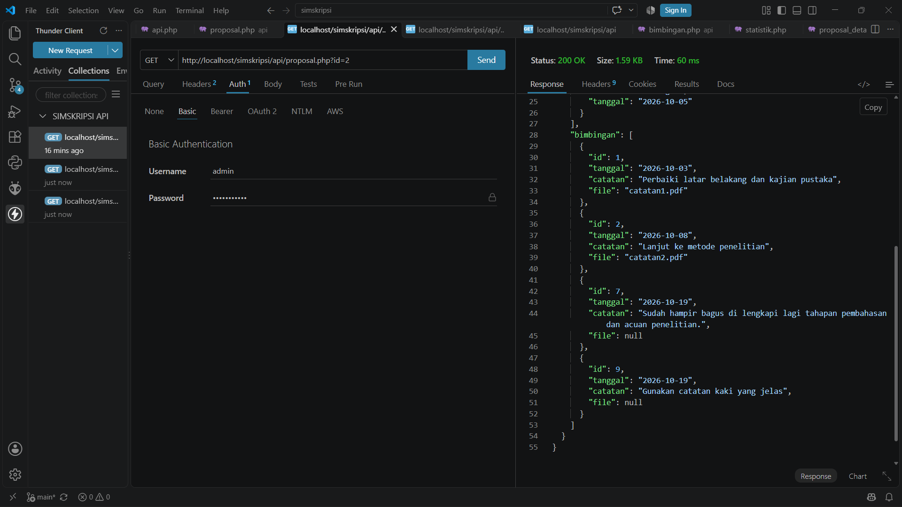 | Detail proposal dengan bimbingan |
| 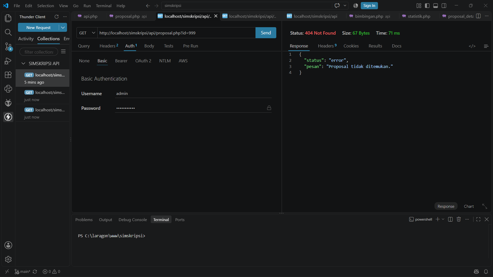 | ID tidak ada, 404 |

**Pengujian di server online:**

| Gambar | Keterangan |
|---|---|
| 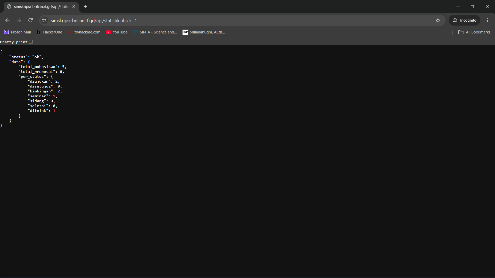 | Statistik setelah login Basic Auth sebagai admin |
| 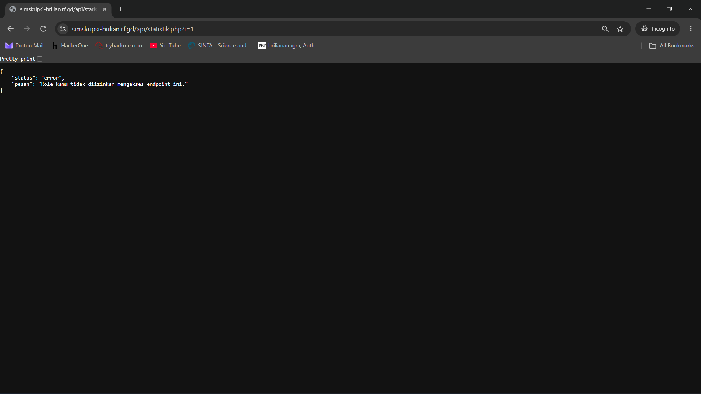 | Mahasiswa membuka statistik, 403 |
| 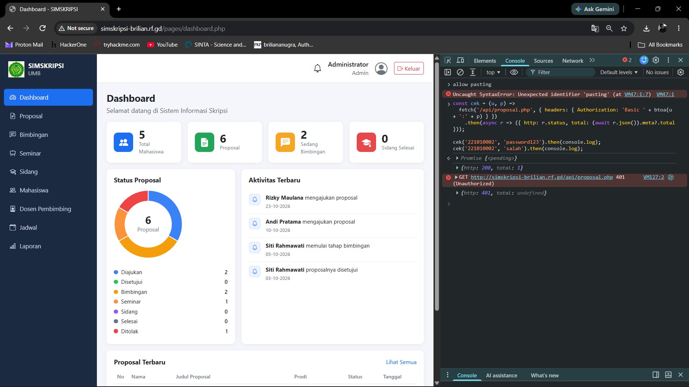 | Password benar menghasilkan `200` dengan satu data. Password salah menghasilkan `401`. Cookie sesi admin ikut terkirim di kedua permintaan |

> **Catatan hosting:** InfinityFree dapat menahan permintaan dari program non-browser, misalnya Thunder Client atau curl, dengan halaman anti-bot berbentuk HTML. Karena itu saya menguji API online lewat browser.

---

## Menjalankan di Komputer Sendiri

Kamu butuh Laragon (atau XAMPP) dengan PHP 8.x dan MySQL, serta Git.

1. **Unduh proyek.** Beri nama folder `simskripsi`, karena `config/app.php` mengatur alamat dasar lokal ke `/simskripsi`.
   ```bash
   cd C:\laragon\www
   git clone https://github.com/briliananugra/websematic-simskripsi.git simskripsi
   ```
2. **Jalankan Laragon** (Start All) dan pastikan Apache dan MySQL aktif.
3. **Buat database kosong** bernama `simskripsi` lewat HeidiSQL atau phpMyAdmin, dengan charset `utf8mb4`.
4. **Impor struktur tabel** dari file `database/simkripsi.sql` ke database itu.
5. **Buat file koneksi.** Salin `config/database.example.php` menjadi `config/database.php`, lalu isi:
   ```php
   $db_host = 'localhost';
   $db_name = 'simskripsi';
   $db_user = 'root';
   $db_pass = '';
   ```
   File `config/database.php` tidak ada di repo karena berisi kredensial dan terdaftar di `.gitignore`.
6. **Isi data contoh.** Buka `http://localhost/simskripsi/database/seed.php` satu kali. Seeder menolak berjalan kalau tabel `users` sudah berisi data, jadi pembukaan kedua tidak menggandakan apa pun. Koneksi di `seed.php` memakai setelan bawaan Laragon (`root`, tanpa password). Ubah empat variabel di bagian atas file kalau setelanmu berbeda.
7. **Buka aplikasi** di `http://localhost/simskripsi/`.

Aplikasi membuat folder `uploads/bimbingan/` saat file pertama diunggah. File `.htaccess` di `uploads/` menolak akses lewat alamat langsung. Pengguna mengunduh file lewat `pages/bimbingan_unduh.php`, yang memeriksa hak akses lebih dulu.

### Catatan deploy ke InfinityFree
- Unggah isi proyek langsung ke `htdocs`, sehingga `index.php` berada di `htdocs/index.php`. `config/app.php` mengenali hosting dan memakai alamat dasar kosong.
- Buat `config/database.php` langsung di server dengan data koneksi hosting.
- Jalankan `database/seed.php` satu kali, lalu hapus dari server.
- `.htaccess` di root meneruskan header `Authorization` ke PHP, supaya Basic Auth berfungsi.
- Buat folder `uploads/bimbingan/` dengan tangan di server, karena `mkdir` dari PHP bisa gagal di hosting gratis.

---

## Akun Demo

Semua akun memakai password **`password123`**.

| Role | Username | Nama |
|---|---|---|
| Admin | `admin` | Administrator |
| Kaprodi | `kaprodi` | Dr. Hendra, M.T. |
| Dosen | `198001012005` | Dr. Ahmad, M.Kom |
| Dosen | `198202022008` | Siti Aminah, M.M. |
| Mahasiswa | `221010001` sampai `221010005` | Andi, Siti Rahmawati, Budi, Dela, Rizky |

---

## Struktur Database

Lima tabel, semuanya InnoDB dengan charset `utf8mb4`:

```
prodi ──< users ──< proposal ──< status_log
                        └──────< bimbingan
```

| Tabel | Isi |
|---|---|
| `prodi` | Program studi |
| `users` | Semua akun. Kolom `role` berisi `admin`, `kaprodi`, `dosen`, atau `mahasiswa`. Password tersimpan sebagai hash |
| `proposal` | Judul, status (`diajukan`, `disetujui`, `bimbingan`, `seminar`, `sidang`, `selesai`, `ditolak`), mahasiswa, dan dosen pembimbing (boleh kosong) |
| `status_log` | Riwayat perubahan status. Timeline dan aktivitas terbaru membacanya |
| `bimbingan` | Catatan bimbingan dan nama file lampiran |

Menghapus proposal ikut menghapus `status_log` dan `bimbingan` miliknya (`ON DELETE CASCADE`). Menghapus dosen mengosongkan `dosen_id` pada proposal yang ia bimbing.

---

## Keamanan

- **Prepared statement** di semua query, jadi input pengguna tidak bisa mengubah isi query (SQL Injection).
- **`password_hash` dan `password_verify`** menangani password. Login memanggil `session_regenerate_id`.
- **Token CSRF** dengan `hash_equals` melindungi semua permintaan POST, termasuk penghapusan.
- **`htmlspecialchars`** membersihkan semua teks yang tampil di halaman (XSS).
- **Validasi di server** untuk setiap form.
- **Unggah file:** server menerima PDF, DOC, dan DOCX sampai 2 MB, mengganti nama file dengan awalan acak, dan menolak akses langsung lewat `.htaccess`. Pengguna mengunduh lewat skrip yang memeriksa hak akses.
- **Hak akses dua lapis:** `wajib_role` membatasi per role, dan `proposal_boleh_dilihat` membatasi per baris data. Web dan API memakai fungsi yang sama.
- **API** mematikan `display_errors` supaya galat PHP tidak merusak JSON. Galat tak terduga dijawab 500 dengan pesan umum, dan detailnya masuk log server.

---

## Pengujian

| Tahap | Cakupan | Hasil |
|---|---|---|
| API di lokal (Thunder Client) | 18 uji: autentikasi, fungsi, error 404/400/405, otorisasi 401/403 | Semua lulus setelah satu perbaikan (lihat bagian berikutnya) |
| Aplikasi web di server online | 20 uji: halaman publik, login, hak akses, CRUD, bimbingan dan unggah file, aturan pengajuan | Semua lulus |
| API di server online (browser) | 17 uji: autentikasi, fungsi, penanganan error, otorisasi, prioritas Basic Auth | Semua lulus |

---

## Bug yang Ditemukan dan Diperbaiki

**API membocorkan data admin ke akun mahasiswa.** Saat saya menguji dengan akun mahasiswa, API mengembalikan data milik admin.

- **Penyebab:** `api_wajib_login()` memeriksa sesi browser lebih dulu. Cookie sesi lama dari login admin mengalahkan kredensial Basic Auth yang terkirim bersamaan.
- **Perbaikan:** fungsi itu sekarang memeriksa Basic Auth lebih dulu dan tidak menyimpan hasilnya ke sesi. Kredensial yang salah langsung mendapat 401 dan tidak jatuh kembali ke sesi.
- **Yang saya pelajari:** uji fungsi biasa meloloskan bug ini. Uji dengan akun berhak rendah menemukannya. Saya juga membedakan 401 ("kamu siapa?") dari 403 ("kamu tidak boleh").

| Uji | Sebelum perbaikan | Sesudah perbaikan |
|---|---|---|
| 13: statistik (mahasiswa) | 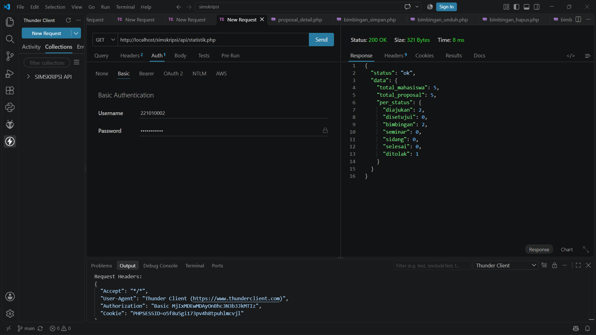 | 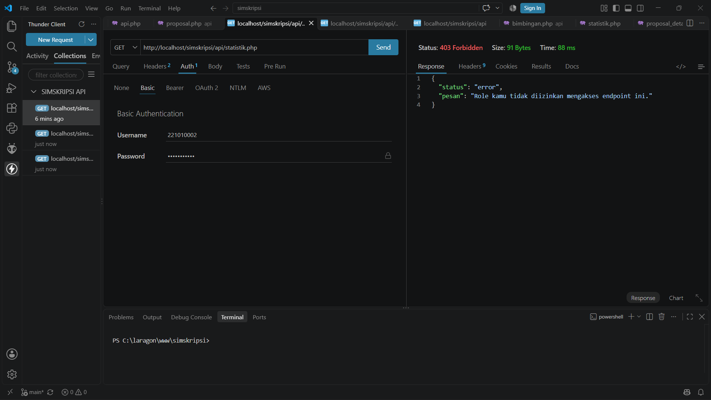 |
| 14: daftar proposal (mahasiswa) | 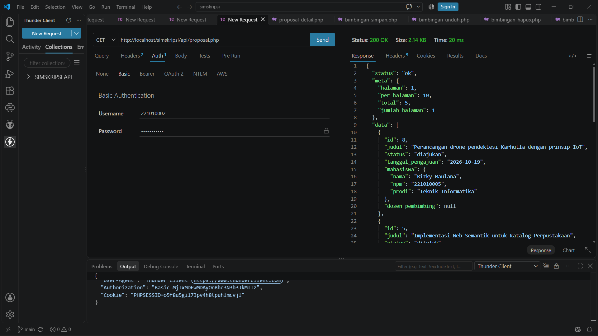 | 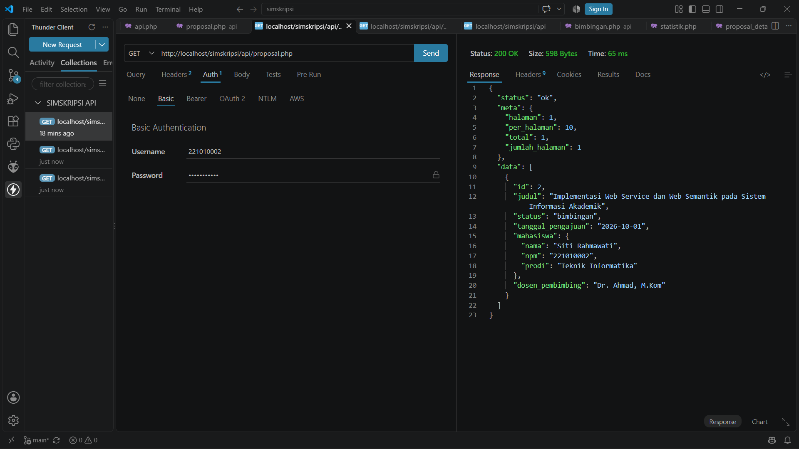 |
| 15: proposal milik orang lain | 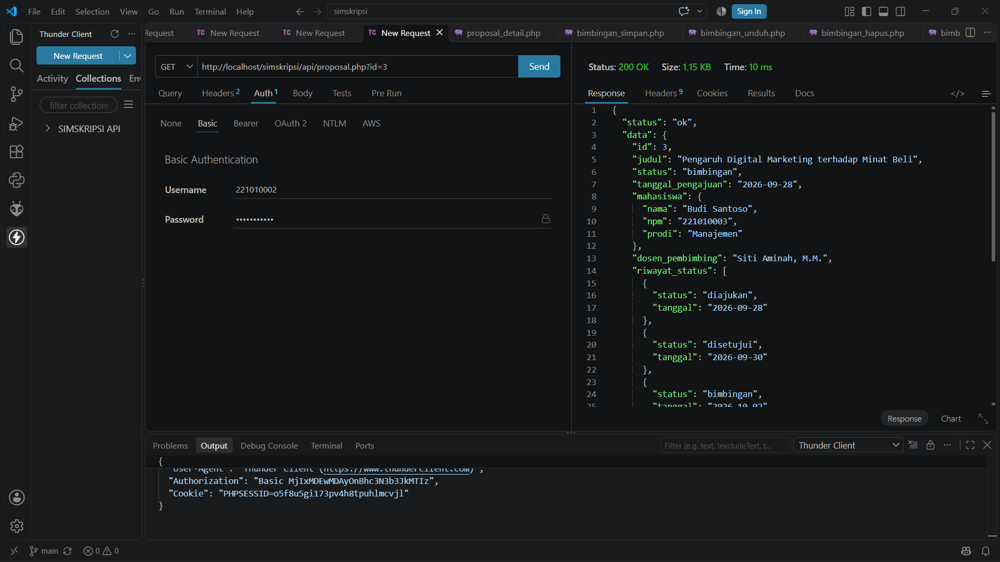 |  |
| 17: bimbingan milik orang lain | 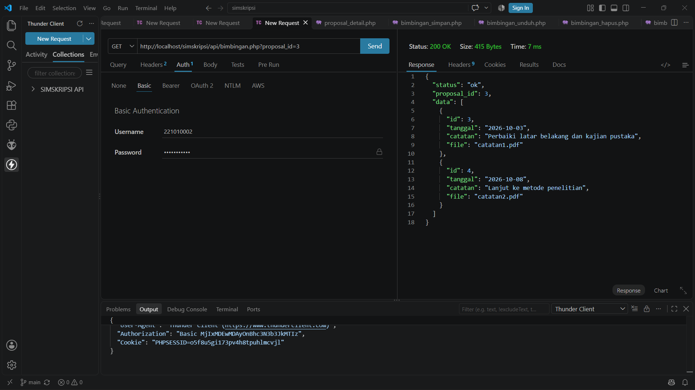 | 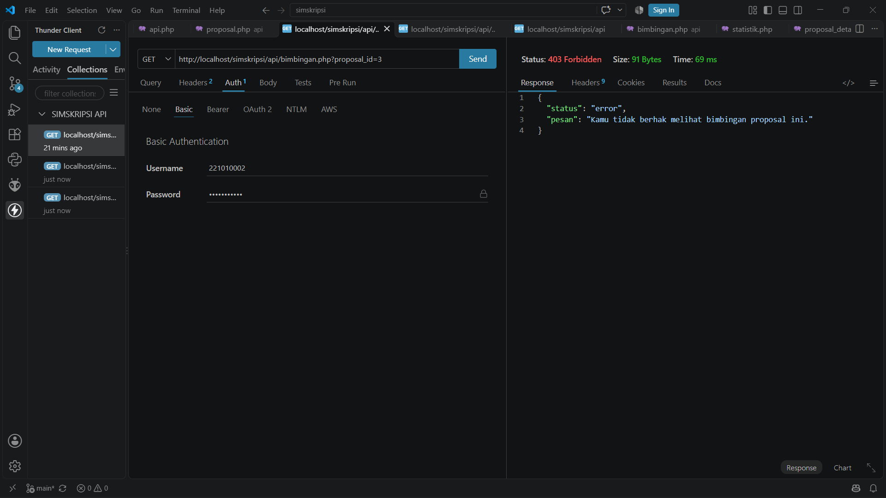 |

---

## Struktur Folder

```
simskripsi/
├── index.php                 landing page
├── .htaccess                 meneruskan header Authorization
├── api/                      bimbingan.php, proposal.php, statistik.php
├── assets/
│   ├── css/                  style.css, landing.css
│   └── img/                  logo_umb.png
├── auth/                     login.php, logout.php
├── config/                   app.php, database.example.php
├── database/                 simkripsi.sql (struktur), seed.php (data contoh)
├── docs/screenshots/         gambar untuk README
├── includes/                 api.php, auth.php, functions.php, header.php, footer.php
├── pages/                    dashboard, dashboard_mahasiswa, proposal*, bimbingan*
└── uploads/                  file unggahan (isinya tidak masuk repo)
```

---

## Keterbatasan

- Menu Seminar, Sidang, Mahasiswa, Dosen Pembimbing, Jadwal, dan Laporan belum jadi. Di sidebar, menu-menu itu masih tautan kosong. Tab Revisi dan Dokumen, serta fitur "Ingat saya" dan "Lupa password", juga belum ada.
- Dosen bisa melihat semua proposal, tidak hanya yang ia bimbing. Untuk membatasinya, ubah fungsi `proposal_boleh_dilihat()`. Web dan API ikut berubah.
- API hanya menerima GET.
- Demo online memakai HTTP, bukan HTTPS.